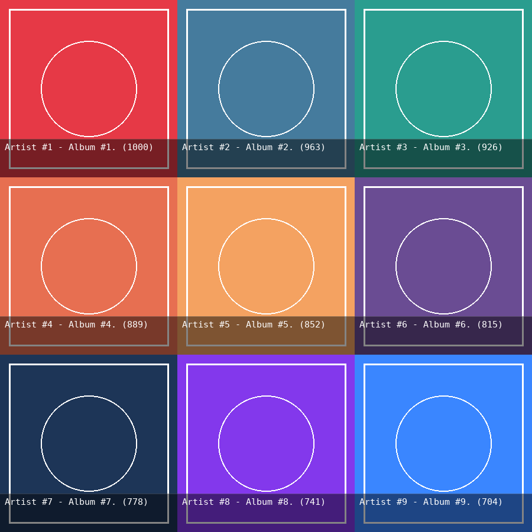

<div align="center">

# 🎵 lastfm-collage-generator

**Create customizable, high-resolution album and artist collages from your Last.fm listening history in Python.**

[](https://pypi.org/project/lastfmcollagegenerator/)
[](https://pypi.org/project/lastfmcollagegenerator/)
[](LICENSE)
[](https://pypi.org/project/lastfmcollagegenerator/)

<br />



<br />

[Installation](#-installation) • [Quickstart](#-quickstart) • [Practical Use Cases](#-practical-use-cases) • [Features](#-features-at-a-glance) • [API Setup](#-getting-lastfm-api-credentials) • [Contributing](CONTRIBUTING.md)

</div>

---

## 📦 Installation

Install `lastfmcollagegenerator` using your favorite package manager:

```bash
# Using pip
pip install lastfmcollagegenerator

# Using uv
uv add lastfmcollagegenerator
```

*Requirements: Python 3.8+ (fully compatible with 3.8, 3.9, 3.10, 3.11, and 3.12).*

---

## ⚡ Quickstart

Generate your first 3x3 weekly album collage in just a few lines of code:

```python
from lastfmcollagegenerator import CollageGenerator

# 1. Initialize with your Last.fm API credentials
generator = CollageGenerator(
    lastfm_api_key="YOUR_API_KEY",
    lastfm_api_secret="YOUR_API_SECRET"
)

# 2. Generate a 3x3 album collage for the past 7 days
image = generator.generate_top_albums_collage(
    username="your_lastfm_username",
    cols=3,
    rows=3,
    period="7day"
)

# 3. Save the resulting Pillow image
image.save("weekly_top_albums.png")
```

---

## 💡 Practical Use Cases

### 1. Social Media Formats (Instagram Stories, Twitter, Wallpapers)

Format your collage instantly for social media using one-click dimension presets. Non-square letterboxed areas are automatically filled with an acrylic Gaussian-blurred backdrop derived from your top artwork:

```python
# Generate a 9:16 vertical image (1080x1920) ready for Instagram Stories
story = generator.generate(
    entity="album",
    username="your_username",
    preset="instagram-story",
    period="1month"
)
story.save("instagram_story.png")

# Available presets:
# - "instagram-story"   : 1080 x 1920 (9:16)
# - "instagram-post"    : 1080 x 1080 (1:1)
# - "twitter-header"    : 1500 x 500  (3:1)
# - "desktop-wallpaper" : 1920 x 1080 (16:9)
# - "desktop-wallpaper-4k": 3840 x 2160 (16:9)
```

---

### 2. Keep Your GitHub Profile Fresh (GitHub Actions)

Showcase your weekly music taste on your personal GitHub Profile README using the bundled GitHub Action:

```yaml
# .github/workflows/weekly-music-recap.yml
name: Update Weekly Music Collage
on:
  schedule:
    - cron: "0 9 * * 1" # Every Monday at 09:00 UTC
  workflow_dispatch:

permissions:
  contents: write

jobs:
  update-collage:
    runs-on: ubuntu-latest
    steps:
      - uses: actions/checkout@v4
      - name: Generate Collage
        uses: paurieraf/lastfm-collage-generator@v1.3.2
        with:
          username: ${{ secrets.LASTFM_USERNAME }}
          entity: album
          cols: "5"
          rows: "5"
          period: 7day
          output-path: assets/weekly-collage.png
          api-key: ${{ secrets.LASTFM_API_KEY }}
          api-secret: ${{ secrets.LASTFM_API_SECRET }}
      - name: Commit updated collage
        run: |
          git config user.name "github-actions[bot]"
          git config user.email "41898282+github-actions[bot]@users.noreply.github.com"
          git add assets/weekly-collage.png
          git commit -m "chore: update weekly listening recap" || echo "No changes"
          git push
```

---

### 3. Discord / Telegram Bots & Web APIs (Async Pipeline)

Build high-concurrency chatbots or REST APIs with non-blocking async generation, streaming binary image bytes in memory without touching the local disk:

```python
import io
from lastfmcollagegenerator import CollageGenerator

generator = CollageGenerator("YOUR_API_KEY", "YOUR_API_SECRET")

# Non-blocking async generation
image = await generator.generate_async(
    entity="artist",
    username="your_username",
    cols=3,
    rows=3,
    period="overall"
)

# Extract binary PNG stream for Discord, Telegram, or FastAPI responses
buffer = io.BytesIO()
image.save(buffer, format="PNG")
buffer.seek(0)
# Send 'buffer.getvalue()' directly to the chat channel or HTTP response
```

---

### 4. Visual Personalization (Themes, Rounded Corners & Clean Mode)

Customize overlay aesthetics or hide text entirely for a pure artwork gallery:

```python
# Rounded squircle corners with neon styling
image = generator.generate(
    entity="album",
    username="your_username",
    cols=4,
    rows=4,
    theme="neon",           # Options: "dark", "light", "glassmorphic", "sunset", "neon"
    corner_radius=14,       # Smooth rounded corners
    border_width=2,         # Border stroke width
    border_color="#00FFAA", # Custom border color
    spacing=8               # Inter-tile gap margin
)

# Clean mode: pure album art grid without text banners
clean_grid = generator.generate(
    entity="album",
    username="your_username",
    cols=5,
    rows=5,
    show_text=False
)
```

---

## ✨ Features at a Glance

- **Multi-Entity Collages**: Generate composite grids for **Top Albums** (`album`), **Top Artists** (`artist`), and **Top Tracks** (`track`).
- **Resilient Artist Imagery**: Scrapes high-resolution artist hero photos directly from Last.fm web pages, overcoming the official Last.fm API artist image deprecation.
- **Flexible Grid Geometry**: Generate grids from **$1 \times 1$ up to $20 \times 20$** (up to 400 tiles) with automatic resolution downscaling (300px $\to$ 150px $\to$ 100px) to safeguard memory.
- **All Last.fm Horizons**: Supports `7day`, `1month`, `3month`, `6month`, `12month`, and `overall`.
- **Multi-Tier Caching & Resilience**: Built-in 2-tier caching (in-memory LRU + persistent SQLite disk cache) and deterministic pastel gradient fallbacks if artwork is missing.
- **Zero System Dependencies**: Bundles official TrueType monospace fonts (`DejaVuSansMono.ttf`) for consistent cross-platform rendering across macOS, Linux, and Docker.

---

## 🔑 Getting Last.fm API Credentials

To fetch your listening data, you need a free Last.fm API account:

1. Create a free account at [Last.fm](https://www.last.fm/) (if you do not have one).
2. Create an API application at [last.fm/api/account/create](https://www.last.fm/api/account/create) (application name and description can be anything you like).
3. Copy your **API Key** and **Shared Secret**.

---

## 📚 Advanced Documentation & Community

- **Contributing & Local Development**: See [CONTRIBUTING.md](CONTRIBUTING.md) for test runners, linters, and offline mock debugging.
- **Maintainer Release Guide**: See [docs/RELEASING.md](docs/RELEASING.md) for PyPI packaging instructions.
- **System Architecture**: See [PROJECT_OVERVIEW.md](PROJECT_OVERVIEW.md) for internal 4-layer object-oriented design and specifications.
- **License**: Released under the [MIT License](LICENSE).
